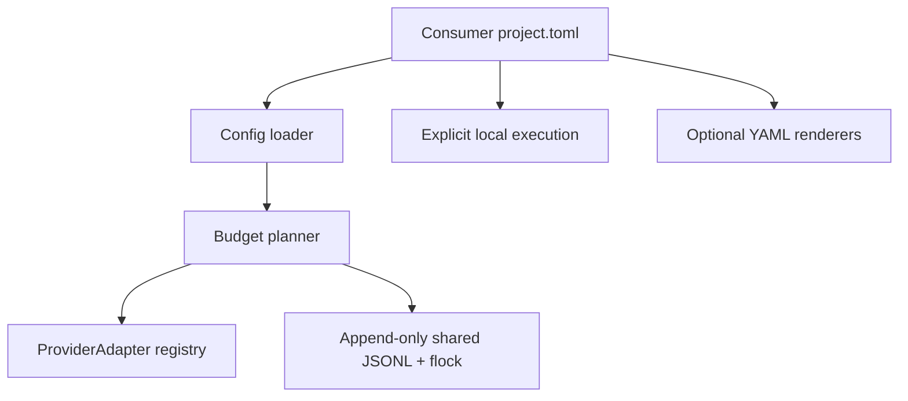

# CI Broker v0.1 architecture

## Responsibility rule

**CI Broker has no knowledge of consumer project names or their internal tests.** Projects provide TOML profiles; providers supply metering and eligibility adapters. Core owns concurrency, selection and the local execution contract. Renderers emit illustrative YAML; dispatch is intentionally absent.



## Source ownership

- `models.py`: `Profile`, `Project`, `Quote`, `ProviderAdapter`, metered/unmetered contracts and trusted extension registry.
- `config.py`: TOML reader and per-account JSON overlay. No importing code from configuration.
- `scheduler.py`: capability gates, independent-verifier requirement, budget headroom, local-first choice; provider-name agnostic except local preference.
- `ledger.py`: POSIX locked append-only reservation/settlement events. Provider IDs represent quota pools; they are shared across projects on the same account.
- `cli.py`: external UX and explicit local command execution. Shell is intentional: command strings are trusted executable project configuration; no execution in `plan`.
- `render.py`: example emitters, not deployment-certified pipelines.

## Stable extension contract

```python
from ci_broker.models import Quote

class MyProvider:
    def quote(self, provider: dict, profile):
        return Quote(expected=2.0, worst=10.0, unit="credits")

    def eligible(self, provider: dict, profile):
        return True, "eligible"
```

A trusted package may advertise `[project.entry-points."ci_broker.adapters"]`. It is loaded ONLY after the operator supplies `--trusted-adapter NAME`, not via project TOML. Keep remote authentication and dispatch out of these methods; they only calculate and check. Vendor-specific sync and dispatch should be separate optional interfaces with explicit user approvals.

## Invariants

1. `plan`, `validate`, `render`, `providers` never dispatch, execute tests or spend remote credits.
2. External providers start disabled and unverified; an unverified quota cannot reserve credits.
3. Reservation uses **timeout worst case** and a configurable protected fraction.
4. Holds remain until explicitly settled or canceled; jobs crossing month boundaries continue to block available budget.
5. `run` requires `--yes` and executes exactly the configured commands in the target directory.
6. A full profile requiring independent verification cannot silently select local in `plan`; local `run` is still a local command and **does not certify independence**.
7. JSON configs never import Python or read secrets.
8. The repository does not offer guaranteed zero cloud costs. Account-level budget enforcement belongs to the provider.

## Known limitations

- No scheduler for granular test DAGs, no cache of completed test nodes, and no mathematical optimization beyond protected quota and local preference.
- No remote dispatch, cloud API billing reconciliation, account discovery, centralized distributed lock or automatic Git integration.
- File locking works for cooperating processes on a POSIX local filesystem, not independently hosted machines or unreliable network file mounts.
- Settled execution accounting is charged to its **reservation month**. The cross-month hold protects budgets conservatively, not precise per-minute billing across months.
- Local process timeout uses Python `subprocess.run`; child processes spawned by a shell may outlive timeout in unusual cases. Use a proper process-group supervisor for untrusted or long-lived commands.
- External provider metadata is illustrative. The operator must verify account quotas and runner capabilities.
